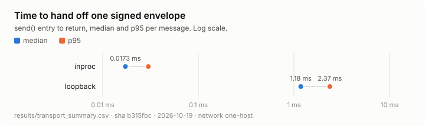
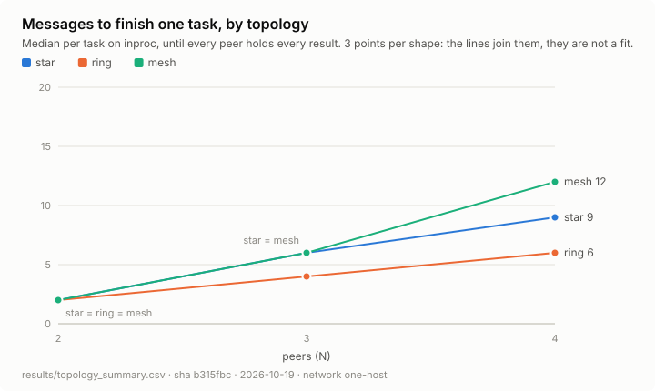
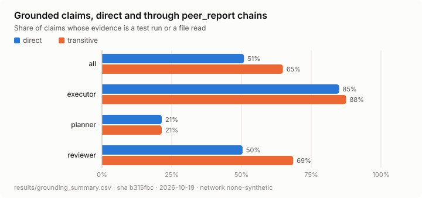
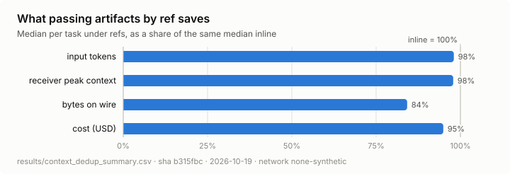
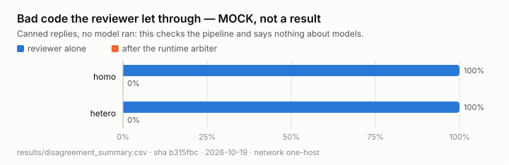

# Results

The five measurements in [EXPERIMENTS.md](EXPERIMENTS.md), what they found, and what they could not
find yet.

Every figure and table between the two markers below is regenerated from CSV by
`python -m experiments.plots`. Nothing in that block is typed by hand. The prose outside it is
hand-written, against the runs whose SHAs appear under each figure. If you regenerate, re-read the
prose against the new tables.

```bash
python -m experiments          # all five measurements -> results/*.csv, then every figure
python -m experiments.plots    # the figures only, from whatever CSVs are in results/
```

`results/` is gitignored. The SVGs under `docs/figures/` and the tables below are the committed
record. The CSVs are reproduced from the SHA and seed under each figure.

## What each number can show

Read this before the figures. Three of the five sources are not a live system.

| | Source | Shows | Does not show |
|---|---|---|---|
| 1 Transport | The real envelope, signing and transport stack, on one host | `inproc` against `loopback`: the cost of leaving the process | `lan`, which needs the four-laptop run; retries and losses only happen once a network is in the path |
| 2 Topology | The same real stack, running an all-gather over 2 to 4 peers on one host, `inproc` and `loopback` | Message and hop counts per shape against theory, and how wall clock grows with them on one host | Whether a mesh's short paths pay off on a network. On one host every peer shares one event loop, so nothing runs in parallel. Three N points show the shape of a curve; they cannot fit one |
| 3 Grounding | The synthetic log from `experiments/fixtures.py` | That the counter is right: chains followed to their root, dangling and cyclic refs handled | How real models ground their claims. The generator was written to the expectation, so it cannot contradict it |
| 4 Context dedup | The same synthetic log, replayed as `inline` and as `refs` | The saving on input tokens, bytes and cost | The cost side. The generator never triggers a blob fetch, so extra round trips are zero by construction |
| 5 Disagreement | **Mock.** `MockLLM`'s canned reply, through the real `Agent.handle()` and the real sandbox, over 30 tasks with held-out tests | That the pipeline runs end to end: execution, sandbox ground truth, blind review, the arbiter replay. The tests drive scripted replies into all four cells of the confusion matrix | Anything about models. Every mock execution fails its tests and every review is unparsed, so `homo` and `hetero` match by construction. The real run is pending |

## Figures

<!-- figures:begin -->

*Generated by `python -m experiments.plots` from the summary CSVs named under each figure. Edit the code, not this block: it is rewritten on every run.*

### 1 — Transport comparison



| condition | messages | median ms | p95 ms | p95 / median | retries / 100 | lost |
|:--|--:|--:|--:|--:|--:|--:|
| inproc | 360 | 0.0173 | 0.03 | 1.74 | 0 | 0 |
| loopback | 360 | 1.18 | 2.37 | 2.01 | 0 | 0 |

`results/transport_summary.csv` · sha `b315fbc` · 2026-10-19 · network `one-host` · 4 nodes · seed 0

### 2 — Message complexity by topology



| transport | shape | N | done | messages | theory | hops | theory | wall median ms | wall p95 ms |
|:--|--:|--:|--:|--:|--:|--:|--:|--:|--:|
| inproc | star | 2 | 60/60 | 2 | 2 | 2 | 2 | 0.153 | 0.373 |
| inproc | star | 3 | 60/60 | 6 | 6 | 3 | 3 | 0.457 | 0.752 |
| inproc | star | 4 | 60/60 | 9 | 9 | 3 | 3 | 0.674 | 1.39 |
| inproc | ring | 2 | 60/60 | 2 | 2 | 2 | 2 | 0.149 | 0.316 |
| inproc | ring | 3 | 60/60 | 4 | 4 | 4 | 4 | 0.282 | 0.593 |
| inproc | ring | 4 | 60/60 | 6 | 6 | 6 | 6 | 0.454 | 0.91 |
| inproc | mesh | 2 | 60/60 | 2 | 2 | 2 | 2 | 0.168 | 0.32 |
| inproc | mesh | 3 | 60/60 | 6 | 6 | 2 | 2 | 0.489 | 0.916 |
| inproc | mesh | 4 | 60/60 | 12 | 12 | 2 | 2 | 0.929 | 1.77 |
| loopback | star | 2 | 60/60 | 2 | 2 | 2 | 2 | 4.22 | 5.57 |
| loopback | star | 3 | 60/60 | 6 | 6 | 3 | 3 | 12.3 | 14.9 |
| loopback | star | 4 | 60/60 | 9 | 9 | 3 | 3 | 19.1 | 22.3 |
| loopback | ring | 2 | 60/60 | 2 | 2 | 2 | 2 | 5.44 | 6.92 |
| loopback | ring | 3 | 60/60 | 4 | 4 | 4 | 4 | 8.9 | 11.1 |
| loopback | ring | 4 | 60/60 | 6 | 6 | 6 | 6 | 13.6 | 16.9 |
| loopback | mesh | 2 | 60/60 | 2 | 2 | 2 | 2 | 4.28 | 6.15 |
| loopback | mesh | 3 | 60/60 | 6 | 6 | 2 | 2 | 12.3 | 15.3 |
| loopback | mesh | 4 | 60/60 | 12 | 12 | 2 | 2 | 23.9 | 28.1 |

`results/topology_summary.csv` · sha `b315fbc` · 2026-10-19 · network `one-host` · 2–4 nodes · seed 0

### 3 — Grounded-claim ratio



| by | claims | direct | transitive | laundered | model prior |
|:--|--:|--:|--:|--:|--:|
| overall: all | 330 | 51% | 65% | 18% | 17% |
| role: executor | 40 | 85% | 88% | 5% | 8% |
| role: planner | 42 | 21% | 21% | 19% | 60% |
| role: reviewer | 248 | 50% | 69% | 20% | 11% |
| model: claude-haiku-4-5 | 98 | 59% | 64% | 29% | 7% |
| model: claude-opus-5 | 134 | 44% | 64% | 9% | 27% |
| model: ollama:qwen2.5-coder | 98 | 52% | 66% | 20% | 13% |

`results/grounding_summary.csv` · sha `b315fbc` · 2026-10-19 · network `none-synthetic` · 4 nodes · seed 20260904

### 4 — Context dedup effect



| median per task | inline | refs | refs / inline |
|:--|--:|--:|--:|
| input tokens | 35,695 | 34,997 | 98% |
| receiver peak context | 36,079 | 35,306 | 98% |
| bytes on wire | 14,499 | 12,208 | 84% |
| cost (USD) | 0.0605 | 0.0575 | 95% |

`results/context_dedup_summary.csv` · sha `b315fbc` · 2026-10-19 · network `none-synthetic` · 4 nodes · seed 20260904

### 5 — Correlated error / disagreement rate



| pair | executor → reviewer | reviews | errors | bad code | caught | false accept | false reject | arbitrated false accept | unparsed | mock |
|:--|--:|--:|--:|--:|--:|--:|--:|--:|--:|--:|
| homo | ollama:llama3.2:3b → ollama:llama3.2:3b | 30 | 0 | 30 | 0% | 100% | -- | 0% | 30 | yes |
| hetero | ollama:llama3.2:3b → ollama:qwen3:8b | 30 | 0 | 30 | 0% | 100% | -- | 0% | 30 | yes |

`results/disagreement_summary.csv` · sha `b315fbc` · 2026-10-19 · network `one-host` · 3 nodes · seed 0

<!-- figures:end -->

## Expected, got, surprised

### 1 — Transport

**Expected.** A median per hop of microseconds in-process, milliseconds on loopback and tens of
milliseconds on LAN. A p95/median near 1 in-process and much worse on LAN. Retries and losses zero
in-process and non-zero on LAN.

**Got.** At the median, an accept takes about 17 µs in-process and 1.2 ms on loopback, about 70
times apart. That matches the expected microseconds and milliseconds. Neither condition retried or
lost a message.

**Surprised.** In-process is not free of jitter. Its p95 is 1.7 times its median, against 2.0 on
loopback, with no network and no socket in the path. The slowest loopback accept took 27 ms, 23
times the median. On one host that tail belongs to the host itself: the event loop, the garbage
collector, connection setup. This run does not separate them. A `lan` p95/median should be read
against this floor, not against 1.

The thesis rests on retries and losses, not on latency. With no network in the path, both are zero
by construction. **The `lan` row is the experiment, and it has not been run.**
`python -m experiments.transport --conditions inproc,loopback,lan --peers config/peers.yaml`
on the four laptops adds it.

### 2 — Message complexity by topology

**Expected.** Counts that follow the table in [EXPERIMENTS.md](EXPERIMENTS.md): O(N) messages for
star and ring, O(N²) for mesh. Ring pays in hops, so it should be slowest. Mesh, at two hops, should
be fastest.

**Got.** Every count equals theory in every cell, and each condition completed 60 of 60 tasks. At
N = 4, star sends 9 messages over 3 hops, ring 6 over 6, and mesh 12 over 2. There are three N points
per shape: the lines in the figure join them, they are not a fit.

Wall clock followed messages, not hops. In the N = 4 rows of the table above, ring is fastest and
mesh slowest on both wires. Divided by its message count, every shape costs about the same per
message: about 0.075 ms in-process, and 2.0 to 2.3 ms on loopback.

**Surprised.** The expected order reversed before any network was involved. The cause is the
harness, not the protocol. On one host, every peer is a task on one asyncio event loop in one
process. The signing, verifying and parsing for a mesh's twelve messages therefore run one after
another on one thread, and the two hops save nothing. Wall clock becomes total work, and total work
is the message count.

[EXPERIMENTS.md](EXPERIMENTS.md) warned that a real network might break the hop model. Here, a
shared CPU breaks it first. On four laptops each peer has its own loop and a mesh's sends overlap,
so hop count should start to matter. The order will be decided by that run, not this one.

### 3 — Grounded-claim ratio

**Expected.** Planners score lowest, because they reason about work that has not happened yet.
Executors score highest. Following `peer_report` chains to their root should separate grounded
citations from laundered ones.

**Got.** That order: executors first, reviewers second, planners last. Following chains raised the
ratio most for reviewers, who cite peers most. It left planners where they were: no planner chain
reached a grounded root.

**Surprised.** Nothing here can surprise. The generator encodes the expectation, and this run
confirms the counter reads it back. One pipeline finding is worth keeping. Some `peer_report`
claims cite a message that is not in the log, and the counter scores them ungrounded and reports
them separately. In a live log, such a claim is a message that was lost or never logged. That is
exactly what the `lan` row of measurement 1 is waiting to find, so the two measurements meet there.

### 4 — Context dedup effect

**Expected.** Substantially fewer input tokens and a lower peak context per agent with refs. More
tasks finishing before context runs out. More round trips, as the cost.

**Got.** A small saving, largest on the wire. At the median, refs cut bytes on the wire by 16%,
cost by 5%, and input tokens by 2%. On this log, an artifact is a few hundred tokens inside a task
of tens of thousands, so passing it by reference can only save a few percent of the input.

- The receiver's peak context fell by the same 2% as its input.
- The peak of the fullest agent in each task did not move.
- The same 3 of 21 tasks exhausted their context under both conditions.

**Surprised.** The trade cannot be weighed on this data. `experiments/fixtures.py` attaches an
artifact only to the last message of a completed task, so the receiver never has work left to do
with it. The hydration policy then never fetches, every ref counts as skipped, and extra round
trips are zero in both rows. Those zeros are a property of the generator, not evidence that refs
are free. `tests/test_measurements.py` drives the fetching path on a hand-built log, so the
mechanism is tested even though this run never reaches it. A live run is needed for both sides.

### 5 — Correlated error / disagreement rate

**Expected.** `homo` lets more bad code through than `hetero`. Two instances of one model share
priors, so the reviewer waves through the mistakes it would have made itself. The runtime arbiter
reads the sandbox's exit code, so it should bring both pairs to zero false accepts.

**Got.** Nothing yet about models: the run above is the mock.
- Its canned reply is prose, so all 30 executions fail their held-out tests and every review is
  unparsed. Both pairs show the same numbers by construction.
- The 100% advisory false-accept rate comes from P2's agent reading an unparsed review as `complete`.
- The arbiter, given the real exit code, refuses all 30.

**Surprised.** The plumbing found two things in P2's layer, reported on PR #9. Both change how the
real run must be read.

1. **A reply with no valid `task_status` counts as `complete`.** A reviewer that fails to answer in
   the schema is scored as an accept, not a reject. A weak model's false-accept rate therefore
   partly measures its JSON, not its judgement, and the table shows `unparsed` for that reason.
2. **`_arbitrate` lets an `exit_code` written by the model outrank the runtime's.** A reviewer that
   claims exit 0 gets failing code past the arbiter. The mock never claims one, so the 0% arbitrated
   rate here does not test this. On a real run, an arbitrated false accept above zero is that leak.

The real run is 90 calls: 30 executions and 60 reviews. All of them go to local models, so it
costs no API money:

```bash
MOCK_LLM=0 python -m experiments.disagreement --pairs homo,hetero --network one-host \
  --homo ollama:llama3.2:3b,ollama:llama3.2:3b --hetero ollama:llama3.2:3b,ollama:qwen3:8b
```

[EXPERIMENTS.md](EXPERIMENTS.md) names Claude as the executor. These defaults are local models so
the run is free; the flags take any pair.

`qwen3:8b` thinks at length and may outrun the 180 s Ollama timeout. Calls that do are recorded as
error rows, not rejects.
